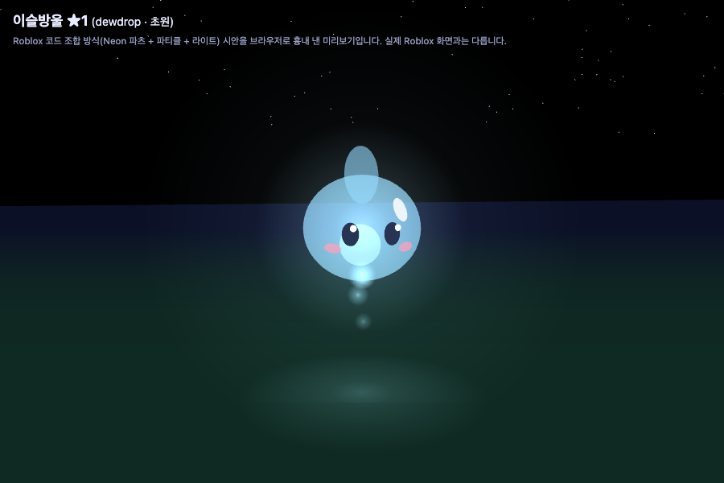
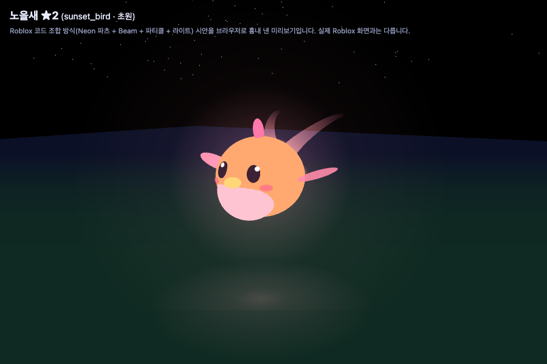

# Glimmerkins

> A Roblox idle-collection game where you bring home adorable light spirits and bring your own little garden to life.

## What is it?

Tiny **light spirits** live all over the world. Some are as clear as dew, some glow inside flower petals, and some sparkle like the night sky. Each one looks and behaves differently.

Players roam meadows, forests, caves and ridges in search of spirits. Bring home the ones you like and let them stay at the springs, gardens and workshops on your plot, and they will gather light there and slowly grow your garden. Your spirits keep working even while the game is closed. When you come back, you see "what your spirits gathered while you were away," spirit by spirit.

Because this is a world of light spirits, the goal is an atmosphere that **glows even more beautifully at night**.

## How to play

1. **Explore** — Wander the regions looking for wild spirits. At first they appear as mysterious balls of light.
2. **Capture** — Shine your lantern on a spirit to reveal its true form. Once it weakens, use a light wick to try to capture it. Higher-grade spirits are harder to catch.
3. **Assign** — Place captured spirits at the Dew Spring, Flowerlight Garden or Crystal Workshop, or take them along as companions (up to 3). Every spirit is good at different jobs.
4. **Idle production** — Assigned spirits gather dew, flowerlight and crystals. Resources keep piling up for a while even when you are offline.
5. **Grow** — Use the materials to upgrade facilities and unlock the next region.
6. **Collect** — Filling the spirit book grants a small bonus for each species. Individuals of the same species have slightly different stats (individual values), so hunting for a better one is part of the fun.

## Regions and spirits

There are **20 species** of spirits, graded from ★1 to ★4.

| Region | Spirits |
|---|---|
| Dew Meadow | Sparkle, Dewdrop, Flower Lamp, Shard Light, Sunset Bird |
| Flowerlight Forest | Moss Puff, Mushroom Lamp, Leaf Bunny, Firefly Squirrel, Rainbow Butterfly |
| Crystal Cave | Crystal Turtle, Starlight Bat, Lighthouse Bear, Moon Fox, Shadow Lantern |
| Aurora Ridge | Snow Penguin, Cloud Sheep, Wind Hawk, Aurora Deer, Star Whale |

  
  
  

*Spirit appearance previews (approximate browser renders). The actual in-game look may differ.*

## A shared garden

- Up to 8 players per server, each with their own plot, play in the same world. You can see other players' companion spirits.
- Everyone sees the decorative spirit swarms drifting over the fields, while capturable spirits appear separately for each player.
- **Planned (after launch)**: co-op capture where you help other players catch spirits, and trading and gifting spirits between players.

## Our promises

- The developer **never sells spirits.** There are no paid gacha, no items that raise odds, and no items that buy spirit stats.
- Paid items focus on cosmetics and convenience.
- There is no PvP that lets players take other players' spirits.

## Development status

- Solo development, **not yet released**.
- Currently building the first version (MVP1), which lets you play through the first region (Dew Meadow).
- The game name, numbers, appearances and spirit names may all change. English names are working translations.

---

### For developers

- `game/` — Roblox game code (Luau, synced to Studio with Rojo)
- `data/` — Game data such as spirits, regions and facilities (shared by the game and the economy simulator)
- `tools/econ_sim/` — Economy simulator (Python)
- `docs/` — Design debates and decision records (in Korean)

See [`CLAUDE.md`](CLAUDE.md) for development rules and commands, and [`docs/dev_environment.md`](docs/dev_environment.md) for the development environment.
