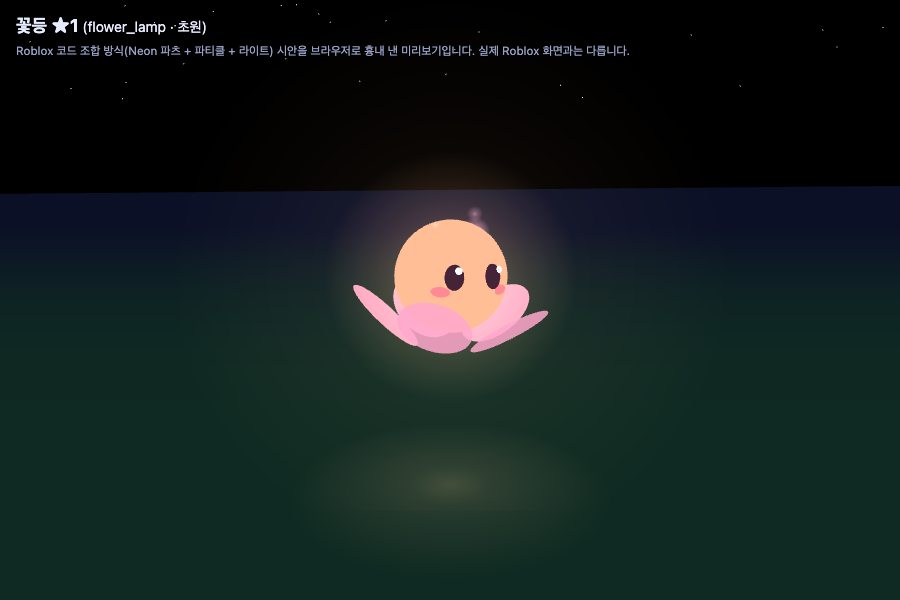

# Glimmerkins (글리머킨즈)

> 귀여운 빛 정령을 데려와, 나만의 작은 정원을 살아 움직이게 하는 Roblox 방치·수집 게임

## 어떤 게임인가요

세상 곳곳에는 작은 **빛 정령**들이 살고 있습니다. 이슬처럼 맑은 정령, 꽃잎 속에서 빛나는 정령, 밤하늘처럼 반짝이는 정령까지 생김새도 성격도 제각각입니다.

플레이어는 정령을 찾아 들판과 숲, 동굴과 능선을 돌아다닙니다. 마음에 드는 정령을 데려와 내 부지의 샘과 정원, 공방에 머물게 하면, 정령들이 그곳에서 빛을 모으며 정원을 조금씩 키워 갑니다. 게임을 꺼 두어도 정령들은 쉬지 않고 일합니다. 다시 들어오면 "자는 동안 정령들이 모은 것"을 정령별로 보여 줍니다.

빛 정령의 세계라서 **밤에 더 아름답게 빛나는** 분위기를 목표로 합니다.

## 이렇게 놀아요

1. **탐험** — 지역을 돌아다니며 야생 정령을 찾습니다. 처음에는 정체를 알 수 없는 빛 덩어리로 보입니다.
2. **포획** — 등롱을 비추면 정령의 모습이 드러납니다. 정령이 약해지면 빛 심지를 써서 포획을 시도합니다. 높은 등급일수록 잡기 어렵습니다.
3. **배치** — 잡은 정령을 이슬 샘·꽃빛 정원·결정 공방에 배치하거나, 동행으로 데리고 다닙니다(최대 3마리). 정령마다 잘하는 일이 다릅니다.
4. **방치 생산** — 배치한 정령들이 이슬·꽃빛·결정을 모읍니다. 접속하지 않은 동안에도 일정 시간까지 쌓입니다.
5. **성장** — 모은 재료로 시설을 강화하고, 다음 지역을 엽니다.
6. **수집** — 도감을 채우면 종마다 작은 보너스가 생깁니다. 같은 종도 개체마다 능력치(개체값)가 조금씩 달라서, 더 좋은 개체를 찾는 재미가 있습니다.

## 지역과 정령

정령은 **20종**, ★1부터 ★4까지 등급이 있습니다.

| 지역 | 사는 정령 |
|---|---|
| 이슬 초원 | 반짝이, 이슬방울, 꽃등, 조각빛, 노을새 |
| 꽃빛 숲 | 이끼뭉치, 버섯등, 잎새 토끼, 반딧불 다람쥐, 무지개 나비 |
| 결정 동굴 | 수정 거북, 별빛 박쥐, 등대곰, 달빛 여우, 그림자 등불 |
| 오로라 능선 | 눈꽃 펭귄, 구름 양, 바람 매, 오로라 사슴, 별무리 고래 |

  
  
  

*정령 외형 미리보기(브라우저 근사 렌더). 실제 게임 화면과는 다를 수 있습니다.*

## 함께하는 정원

- 한 서버에 최대 8명이 각자의 부지를 갖고 같은 세계에서 플레이합니다. 다른 플레이어의 동행 정령도 보입니다.
- 들판을 떠다니는 장식 정령 무리는 모두가 함께 보고, 포획 대상 정령은 플레이어마다 따로 나타납니다.
- **예정(출시 후)**: 다른 플레이어의 포획을 거드는 협동 포획, 플레이어끼리 정령을 주고받는 교환·선물.

## 우리의 약속

- 개발자는 **정령을 팔지 않습니다.** 유료 뽑기, 확률을 올려 주는 상품, 정령 능력치를 사는 상품도 없습니다.
- 유료 상품은 외형과 편의 기능 중심입니다.
- 다른 플레이어의 정령을 빼앗는 PvP는 없습니다.

## 개발 현황

- 1인 개발, **미출시**.
- 현재는 첫 지역(이슬 초원)을 끝까지 즐길 수 있는 첫 버전(MVP1)을 만드는 중입니다.
- 게임 이름, 수치, 외형은 모두 바뀔 수 있습니다.

---

### 개발자용 안내

- `game/` — Roblox 게임 코드(Luau, Rojo로 Studio와 동기화)
- `data/` — 정령·지역·시설 등 게임 데이터(게임과 경제 시뮬레이터가 함께 사용)
- `tools/econ_sim/` — 경제 시뮬레이터(Python)
- `docs/` — 설계 토론과 결정 기록

개발 규칙과 명령은 [`CLAUDE.md`](CLAUDE.md), 개발 환경은 [`docs/dev_environment.md`](docs/dev_environment.md)를 참고하세요.
